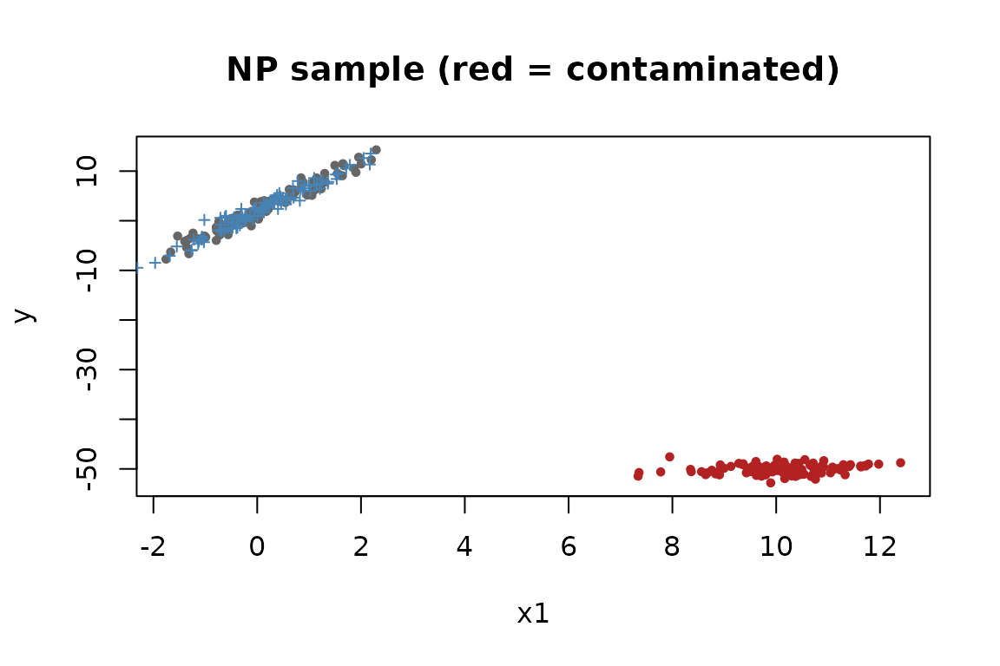

# Gaussian regression: model variants and severe contamination

``` r

library(bayesSampleMix)
```

## Model and algorithm

The target model is $`y = x'\beta + \varepsilon`$, $`\varepsilon \sim
N(0,\sigma^2)`$, with priors $`\beta \sim N(0, 25 I)`$ and
$`\sigma^2 \sim
IG(2, 1)`$ (see
[`?mixture_prior`](https://dapr12.github.io/bayesSampleMix/reference/mixture_prior.md)).
All full conditionals are conjugate, so the sampler is a pure Gibbs
sampler:

1.  $`z_j \mid \cdot`$ — Bernoulli, from the ratio of the two component
    densities;
2.  $`\pi \mid z`$ — Beta;
3.  $`\beta, \sigma^2 \mid \cdot`$ — normal / inverse-gamma given the P
    sample and the NP units with $`z_j = 1`$;
4.  contaminating component — $`\mu_0, \tau^2`$ (M0, Mjoint) or a rival
    regression $`\beta_{bad}, \sigma^2_{bad}`$ (M1).

## Data with 50% severe contamination

Half of the NP units have covariates centred at 10 (far outside the P
support) and outcomes around $`-50`$, unrelated to the target regression
$`y = 2 + 5x`$.

``` r

d <- simulate_mixture_data("gaussian", n_prob = 100, n_nonprob = 200,
                           contamination = 0.5, beta = c(2, 5),
                           bad_beta = c(-50, 0), x_shift = 10, seed = 123)
plot(y ~ x1, data = d$nonprob, col = ifelse(contaminated == 1, "firebrick", "grey40"),
     pch = 19, cex = 0.6, main = "NP sample (red = contaminated)")
points(y ~ x1, data = d$prob, col = "steelblue", pch = 3, cex = 0.6)
```



``` r

fits <- lapply(c(M0 = "M0", Mjoint = "Mjoint", M1 = "M1"), function(m)
  mixture_fit(y ~ x1, d$prob, d$nonprob, model = m,
              n_iter = 2000, burnin = 1000, seed = 1))
pooled <- baseline_fit(y ~ x1, rbind(d$prob, d$nonprob[names(d$prob)]),
                       n_iter = 2000, burnin = 1000, seed = 1)
rbind(truth = c(2, 5), naive_pooled = coef(pooled), t(sapply(fits, coef)))
#>              (Intercept)        x1
#> truth           2.000000  5.000000
#> naive_pooled    1.833503 -4.918666
#> M0              1.935399  4.952606
#> Mjoint          1.935399  4.952606
#> M1              1.933122  4.948577
sapply(fits, contamination)
#>               M0    Mjoint        M1
#> mean   0.5004272 0.5004272 0.5000318
#> median 0.5007562 0.5007562 0.5000086
#> lower  0.4369659 0.4369659 0.4335658
#> upper  0.5687666 0.5687666 0.5722262
```

With such strong separation all three variants identify the contaminated
units; naive pooling produces a meaningless fit. (`M0` and `Mjoint` even
give identical draws here: the outcomes alone classify every unit with
probability 0 or 1 to machine precision, so with the same seed both
chains make exactly the same allocations.)

``` r

s <- filter_scores(fits$Mjoint)
range(s[d$nonprob$contaminated == 1])
#> [1] 0 0
range(s[d$nonprob$contaminated == 0])
#> [1] 1 1
plot(fits$Mjoint, type = "contamination")
```


The posterior of $`1-\pi`$ is centred near 0.5 but has genuine spread:
it is a population-level parameter. The fraction of the *observed* NP
units that are contaminated is reported separately:

``` r

summary(fits$Mjoint)$contamination
#>                             mean         sd      2.5%       50%     97.5%
#> contamination          0.5004272 0.03440216 0.4369659 0.5007562 0.5687666
#> contamination_realized 0.5000000 0.00000000 0.5000000 0.5000000 0.5000000
#>                             ess        mcse
#> contamination          1030.616 0.001071611
#> contamination_realized       NA          NA
```

## When does the covariate term matter?

`Mjoint` adds information from the covariates. When contaminated units
differ only moderately in their outcomes but lie away from the P
covariate distribution, the leverage term sharpens classification.
Compare filter-score AUCs on a harder design, in which the contaminating
regression $`y = 4 + 3x`$ crosses the target line $`y = 2 + 5x`$ at
$`x = 1`$, inside the region where contaminated covariates are
concentrated:

``` r

d2 <- simulate_mixture_data("gaussian", n_prob = 150, n_nonprob = 300,
                            contamination = 0.3, beta = c(2, 5),
                            bad_beta = c(4, 3), x_shift = 2, seed = 7)
f0 <- mixture_fit(y ~ x1, d2$prob, d2$nonprob, model = "M0",
                  n_iter = 2000, burnin = 1000, seed = 1)
fj <- mixture_fit(y ~ x1, d2$prob, d2$nonprob, model = "Mjoint",
                  n_iter = 2000, burnin = 1000, seed = 1)
labels <- 1 - d2$nonprob$contaminated
c(M0 = filter_auc(labels, filter_scores(f0)),
  Mjoint = filter_auc(labels, filter_scores(fj)))
#>        M0    Mjoint 
#> 0.8738624 0.9342857
rbind(truth = c(2, 5), M0 = coef(f0), Mjoint = coef(fj))
#>        (Intercept)       x1
#> truth     2.000000 5.000000
#> M0        1.870961 4.371100
#> Mjoint    1.945880 4.809154
```

The covariate term improves both classification and the coefficient
estimates, but some bias remains: contaminated units close to the
crossing point are genuinely indistinguishable from compatible ones. No
filter can remove contamination that is observationally equivalent to
the target model — which is also why such units do little harm.

## Settings worth knowing

- `mixture_control(c_infl = )` controls how much more dispersed
  contaminated covariates are assumed to be (default 4 for the Gaussian
  family).
- `mixture_prior(pi_shape1, pi_shape2)` encodes prior beliefs about the
  NP sample’s reliability.
- For model `"M1"`, `mixture_control(m1_update = "original")` reproduces
  the original research code, which ignored the units allocated to the
  rival regression when there were at most $`p + 1`$ of them; the
  default `"exact"` uses the correct full conditional.
- Posterior draws for further analysis: `as.matrix(fit, "all")`, e.g.
  `coda::mcmc(as.matrix(fit))`.
