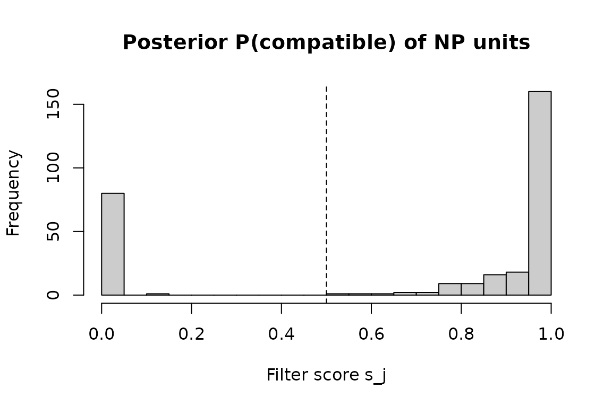

# Introduction to bayesSampleMix

``` r

library(bayesSampleMix)
```

## The problem

A *probability sample* (P) is drawn with a known design and is trusted
to represent the target population, but it is often small. A
*non-probability sample* (NP) — web panels, administrative extracts,
opt-in surveys — is cheaper and larger, but some of its units may follow
a different outcome–covariate relationship than the target population,
or lie outside its covariate support. We call such units *contaminated*.

Two simple strategies are common:

- **Probability-only:** ignore the NP sample. Unbiased, but imprecise.
- **Naive pooling:** treat every NP unit as if it came from the target
  population. Precise, but biased whenever contamination is present —
  and more data does not reduce that bias.

**Contamination-aware integration** sits between the two. Each NP unit
$`j`$ receives a latent indicator $`z_j`$ ($`1`$ = compatible with the
target model). Compatible units are pooled with the P sample;
contaminated units are absorbed by a separate mixture component. The
posterior probability $`s_j = P(z_j = 1 \mid \text{data})`$ — the
*filter score* — tells you how much each NP unit is trusted, and the
posterior of $`1 - \pi`$ estimates the contamination fraction. Because
only compatible units inform the target regression, the estimator is
close to probability-only when the NP sample is heavily contaminated and
close to the pooled estimator when it is clean.

## Model

For P units, $`y_i \sim f(y \mid x_i, \beta)`$ (Gaussian, logistic or
Poisson regression). For NP units,

``` math
z_j \sim \text{Bernoulli}(\pi), \qquad
p(y_j, x_j \mid z_j) = \begin{cases}
f(y_j \mid x_j, \beta)\, g_1(x_j) & z_j = 1\\
h(y_j \mid x_j, \phi)\, g_0(x_j) & z_j = 0.
\end{cases}
```

Three variants are available through `model`:

| model | contaminating outcome density $`h`$ | covariate term |
|----|----|----|
| `"M0"` | covariate-free ($`N(\mu_0,\tau^2)`$, Bernoulli($`q`$), Poisson($`\lambda_0`$)) | none |
| `"Mjoint"` (default) | as M0 | $`g_1 = N(\hat\mu_P, \hat\Sigma_P)`$, $`g_0 = N(\hat\mu_P, c\,\hat\Sigma_P)`$ on continuous covariates |
| `"M1"` | rival regression with its own coefficients | none |

The `Mjoint` covariate term compares each NP unit’s continuous
covariates with the P-sample distribution: units at large Mahalanobis
distance are more plausible under the inflated contaminating density and
are down-weighted.

Estimation uses a data-augmentation Gibbs sampler; the target block is
updated with conjugate Gibbs steps (Gaussian), Pólya–Gamma augmentation
(logistic) or a Laplace-proposal Metropolis–Hastings step (Poisson). See
[`?mixture_fit`](https://dapr12.github.io/bayesSampleMix/reference/mixture_fit.md)
for details.

## A first example

[`simulate_mixture_data()`](https://dapr12.github.io/bayesSampleMix/reference/simulate_mixture_data.md)
generates a P sample and an NP sample with a known fraction of
contaminated units.

``` r

d <- simulate_mixture_data("gaussian", n_prob = 150, n_nonprob = 300,
                           contamination = 0.3, beta = c(2, 5),
                           x_shift = 1.5, seed = 2026)
head(d$nonprob)
#>             y         x1 contaminated
#> 1   9.3893016  1.4481788            0
#> 2   1.3537165 -0.1846723            0
#> 3 -11.2648644 -2.5128208            0
#> 4  -0.4734667  0.6404102            1
#> 5   4.0276943  0.6013861            0
#> 6  -8.2719326  2.7376824            1
table(d$nonprob$contaminated)
#> 
#>   0   1 
#> 210  90
```

Before fitting, check how well the NP sample overlaps the P sample in
the covariate space:

``` r

overlap_diagnostics(d$prob["x1"], d$nonprob["x1"])
#> Covariate overlap diagnostics (P vs NP)
#>   Overlap coefficient (OC):       0.846
#>   Exceedance fraction (EF, >q99): 0.060
#>   Propensity-score AUC:           0.627
```

Fit the contamination-aware model and the two reference estimators:

``` r

fit <- mixture_fit(y ~ x1, prob_data = d$prob, nonprob_data = d$nonprob,
                   family = "gaussian", n_iter = 3000, burnin = 1000, seed = 1)
prob_only <- baseline_fit(y ~ x1, d$prob, n_iter = 2000, burnin = 1000, seed = 1)
pooled <- baseline_fit(y ~ x1, rbind(d$prob, d$nonprob[names(d$prob)]),
                       n_iter = 2000, burnin = 1000, seed = 1)
rbind(truth = c(2, 5), prob_only = coef(prob_only), naive_pooled = coef(pooled),
      mixture = coef(fit))
#>              (Intercept)       x1
#> truth          2.0000000 5.000000
#> prob_only      2.1060952 5.051342
#> naive_pooled   0.1689265 1.312062
#> mixture        2.0515891 5.033711
```

The naive pooled estimate is pulled away from the truth by the
contaminated units; the mixture estimate is close to the truth and,
using the compatible NP units, more precise than the probability-only
estimate:

``` r

rbind(prob_only = apply(as.matrix(prob_only)[, 1:2], 2, sd),
      mixture = apply(as.matrix(fit)[, 1:2], 2, sd))
#>           (Intercept)         x1
#> prob_only   0.0755194 0.06649712
#> mixture     0.0489077 0.04644786
```

## Interpreting the output

``` r

summary(fit)
#> Bayesian contamination-mixture fit (bayesSampleMix)
#> Call: mixture_fit(formula = y ~ x1, prob_data = d$prob, nonprob_data = d$nonprob, 
#>     family = "gaussian", n_iter = 3000, burnin = 1000, seed = 1)
#> Family:  Gaussian (identity link)
#> Model:   Mjoint (contaminating density + covariate leverage term)
#> Leverage covariates: x1  (inflation c = 4)
#> Samples: n_P = 150, n_NP = 300
#> MCMC:    3000 iterations, burn-in 1000, thin 1 -> 2000 draws
#> 
#> Target-model coefficients (posterior; 95% credible intervals):
#>             mean     sd 2.5%  50% 97.5%  ess    mcse
#> (Intercept) 2.05 0.0489 1.95 2.05  2.15 1650 0.00120
#> x1          5.03 0.0464 4.94 5.03  5.13 1760 0.00111
#> 
#> Error variance:
#>        mean     sd  2.5%   50% 97.5%  ess    mcse
#> sigma2 0.83 0.0659 0.711 0.825 0.968 1120 0.00197
#> 
#> Contamination:
#>                         mean     sd  2.5%   50% 97.5%  ess     mcse
#> contamination          0.306 0.0284 0.253 0.307 0.364 1350 0.000772
#> contamination_realized 0.305 0.0109 0.287 0.303 0.327 1340 0.000297
#> 
#> Filter scores of NP units (s_j = posterior P(compatible)):
#>   expected compatible units: 208.4 of 300; units with s_j < 0.5: 81; mean entropy: 0.106
```

- **Target-model coefficients** are posterior summaries of $`\beta`$
  from the retained draws: posterior mean and standard deviation, an
  equal-tailed credible interval, effective sample size (`ess`) and
  Monte Carlo standard error (`mcse`).
- **Contamination** reports $`1-\pi`$ (the probability that a new NP
  unit is contaminated) and the realised fraction of the observed NP
  units allocated to the contaminating component.
- **Filter scores** $`s_j`$ are unit-level posterior probabilities of
  compatibility:

``` r

s <- filter_scores(fit)
tapply(s, d$nonprob$contaminated, summary)
#> $`0`
#>    Min. 1st Qu.  Median    Mean 3rd Qu.    Max. 
#>  0.5390  0.9432  0.9915  0.9522  0.9983  1.0000 
#> 
#> $`1`
#>    Min. 1st Qu.  Median    Mean 3rd Qu.    Max. 
#>  0.0000  0.0000  0.0000  0.0941  0.0000  0.9940
filter_auc(1 - d$nonprob$contaminated, s)   # known labels: simulation only
#> [1] 0.9642328
plot(fit, type = "scores")
```



Always inspect the chains:

``` r

plot(fit, type = "trace")
```


## Where next

- [`vignette("gaussian-model")`](https://dapr12.github.io/bayesSampleMix/articles/gaussian-model.md):
  the three model variants and severe contamination.
- [`vignette("logistic-model")`](https://dapr12.github.io/bayesSampleMix/articles/logistic-model.md):
  binary outcomes with Pólya–Gamma augmentation.
- [`vignette("poisson-model")`](https://dapr12.github.io/bayesSampleMix/articles/poisson-model.md):
  count outcomes.
