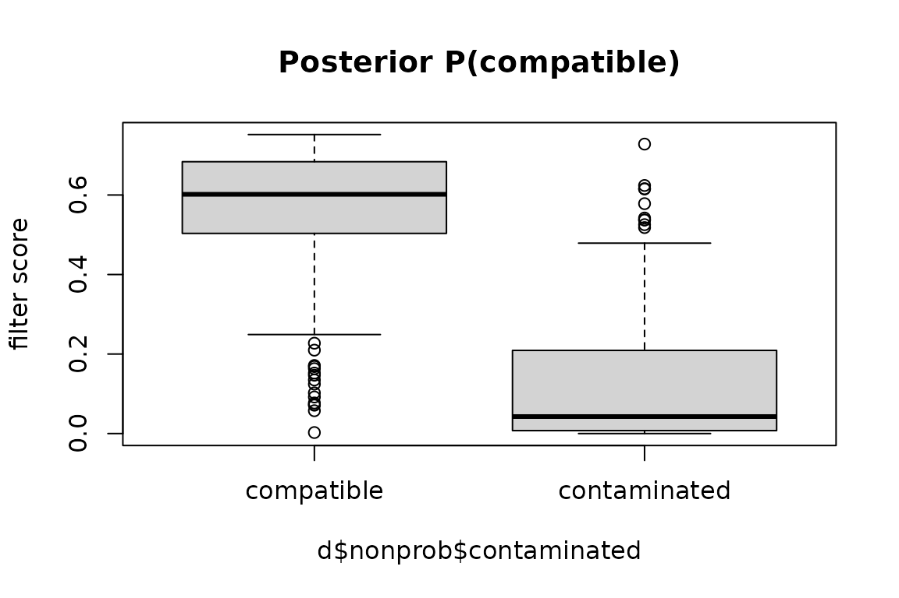

# Logistic regression with Pólya–Gamma augmentation

``` r

library(bayesSampleMix)
```

## Model and algorithm

The target model is $`P(y = 1 \mid x) = \text{logit}^{-1}(x'\beta)`$.
For contaminated units, `M0`/`Mjoint` use a Bernoulli($`q`$) density
with $`q \sim \text{Beta}(1, 1)`$, and `M1` a rival logistic regression.

The coefficient update uses Pólya–Gamma data augmentation (Polson, Scott
and Windle, 2013): conditional on $`\omega_i \sim PG(1, x_i'\beta)`$,
the posterior of $`\beta`$ is Gaussian with covariance
$`V = (X'\Omega X + B_0^{-1})^{-1}`$ and mean $`V X'(y - 1/2)`$. As in
the original implementation, $`PG(1, z)`$ variables are drawn from the
first $`K`$ terms (`mixture_control(pg_terms = 128)`) of their
sum-of-gammas representation plus a correction for the mean of the
omitted tail — an accurate approximation rather than an exact draw.

Binary outcomes carry little information per unit, so a contaminating
mechanism must differ substantially (e.g. sign-flipped effects) to bias
a logistic fit, and identifying individual contaminated units relies
heavily on the covariate term of `Mjoint`.

## Example: sign-flipping contamination

``` r

beta <- c(0.2, 1, -0.8)
d <- simulate_mixture_data("binomial", n_prob = 400, n_nonprob = 400,
                           contamination = 0.3, beta = beta, x_shift = 2,
                           seed = 201)
head(d$nonprob)
#>   y         x1         x2 contaminated
#> 1 0  2.8067144  1.0560083            1
#> 2 0 -1.1742917  0.2706309            0
#> 3 1  0.7454518 -0.6571806            0
#> 4 0  2.2295758  1.9585892            1
#> 5 1  0.4082529 -0.1934783            0
#> 6 0 -0.7303275 -0.3577141            0
```

Contaminated units have covariates shifted by +2 and slopes of opposite
sign.

``` r

fit <- mixture_fit(y ~ x1 + x2, d$prob, d$nonprob, family = "binomial",
                   n_iter = 1500, burnin = 500, seed = 1)
pooled <- baseline_fit(y ~ x1 + x2, rbind(d$prob, d$nonprob[names(d$prob)]),
                       family = "binomial", n_iter = 1500, burnin = 500, seed = 1)
prob_only <- baseline_fit(y ~ x1 + x2, d$prob, family = "binomial",
                          n_iter = 1500, burnin = 500, seed = 1)
rbind(truth = beta, prob_only = coef(prob_only), naive_pooled = coef(pooled),
      mixture = coef(fit))
#>              (Intercept)        x1         x2
#> truth          0.2000000 1.0000000 -0.8000000
#> prob_only      0.3608662 1.0401683 -0.7043355
#> naive_pooled   0.1946997 0.4646196 -0.5802525
#> mixture        0.4092303 1.1871558 -0.7724388
summary(fit)
#> Bayesian contamination-mixture fit (bayesSampleMix)
#> Call: mixture_fit(formula = y ~ x1 + x2, prob_data = d$prob, nonprob_data = d$nonprob, 
#>     family = "binomial", n_iter = 1500, burnin = 500, seed = 1)
#> Family:  Binomial (logit link)
#> Model:   Mjoint (contaminating density + covariate leverage term)
#> Leverage covariates: x1, x2  (inflation c = 2.5)
#> Samples: n_P = 400, n_NP = 400
#> MCMC:    1500 iterations, burn-in 500, thin 1 -> 1000 draws
#> 
#> Target-model coefficients (posterior; 95% credible intervals):
#>               mean    sd   2.5%    50%  97.5% ess    mcse
#> (Intercept)  0.409 0.110  0.202  0.408  0.627 436 0.00526
#> x1           1.190 0.137  0.941  1.180  1.460 244 0.00875
#> x2          -0.772 0.123 -1.020 -0.767 -0.529 261 0.00761
#> 
#> Contamination:
#>                         mean     sd  2.5%   50% 97.5% ess    mcse
#> contamination          0.564 0.0468 0.473 0.564 0.656 123 0.00423
#> contamination_realized 0.565 0.0411 0.478 0.565 0.643 118 0.00378
#> 
#> Filter scores of NP units (s_j = posterior P(compatible)):
#>   expected compatible units: 173.9 of 400; units with s_j < 0.5: 179; mean entropy: 0.521
```

The coefficient estimates are close to the truth, whereas naive pooling
attenuates both slopes. Note, however, that the contamination fraction
is **over-estimated** (true value 0.3). Binary outcomes say little about
individual units, and the covariate-free contaminating density
Bernoulli($`q`$) is itself a plausible description of many compatible
units, so units that fit both components about equally well are partly
allocated to the contaminating one; the `Mjoint` covariate term
additionally assigns compatible NP units in the tails of the P covariate
distribution to it. In 50 simulated data sets of this design the
posterior mean of $`1-\pi`$ ranged from 0.50 to 0.70, while the
coefficient z-scores were consistent with standard normal variation (see
`inst/validation/calibrate_tolerances.R`). The error is conservative —
fewer NP units are pooled, so the posterior is wider than an oracle fit
would be — but $`1-\pi`$ should be read as the weight of a “background”
component rather than as the share of units generated by a different
mechanism. Check also its effective sample size, which is lower than for
the coefficients.

``` r

s <- filter_scores(fit)
filter_auc(1 - d$nonprob$contaminated, s)
#> [1] 0.9371429
boxplot(s ~ d$nonprob$contaminated, names = c("compatible", "contaminated"),
        ylab = "filter score", main = "Posterior P(compatible)")
```



## Predictions

[`predict()`](https://rdrr.io/r/stats/predict.html) returns posterior
summaries of the target-population success probability:

``` r

nd <- data.frame(x1 = c(-1, 0, 1), x2 = 0)
predict(fit, nd)
#>         fit       lwr       upr
#> 1 0.3158785 0.2495125 0.3872048
#> 2 0.6006121 0.5502591 0.6517365
#> 3 0.8299665 0.7783965 0.8767027
```
